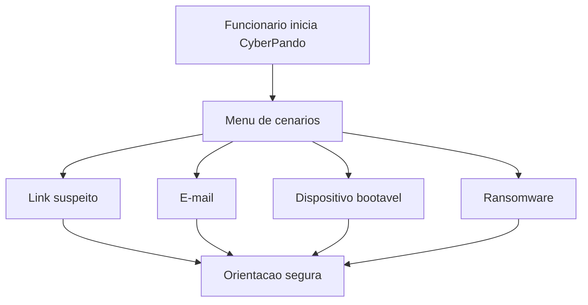

# 🛡️ CyberPando
<p align="center">
  
  <a href="https://github.com/panda12332145/CyberPando/commits/main"></a>
  <a href="https://github.com/panda12332145/CyberPando"></a>
  
  
</p>
---
## 🔖 Resumo

Ferramenta interativa de **terminal** para treinar funcionários a identificar e reagir a questões de segurança digital no ambiente corporativo: analisa links suspeitos, e-mails, dispositivos bootáveis desconhecidos e cenários de ransomware, guiando o usuário pela interface visual para decisões seguras.

### ✨ Funcionalidades Principais

- ✅ Interface visual no terminal (menu interativo)
- ✅ Análise de links suspeitos e e-mails
- ✅ Reconhecimento de dispositivos bootáveis desconhecidos
- ✅ Simulação de resposta a ransomware
- ✅ Futuras funcionalidades planejadas (ver seção abaixo)

## 📽 Demonstração

```text
$ python CyberPando.py

   CyberPando 🛡
   [1] Analisar link suspeito
   [2] Analisar e-mail
   [3] Dispositivo bootável desconhecido
   [4] Cenário de ransomware
   ...
```

## ⚙️ Explicação das Partes Importantes

### Menu interativo do terminal

```python
# interface visual no terminal que direciona o usuário
# para cada cenário de segurança digital corporativa
print('   CyberPando 🛡')
```

> Ponto de entrada única que despacha para cada análise — usabilidade para quem não é da área de TI.

### Análise de indicadores

```python
# avalia características do link/e-mail recebido e
# devolve orientação sobre risco e próximos passos
```

> Cada cenário aplica heurísticas simples de verificação e explica o raciocínio ao usuário.

###Motivação

Eu e **Douglas Nunes** criamos este repositório com o objetivo de disponibilizar uma ferramenta prática e acessível para aumentar a consciência sobre segurança digital nas empresas. Ao identificar ameaças digitais e oferecer orientações sobre como reagir, o **CyberPando** busca contribuir para um ambiente de trabalho mais seguro e resiliente contra ciberataques.

---

## 🔄 Fluxo de Trabalho / Arquitetura



## 📂 Estrutura do Projeto

```plaintext
CyberPando/
├── CyberPando.py    # Ferramenta interativa
├── imagem.png       # Ilustração
├── LICENSE
└── README.md
```

## 🛠️ Tecnologias

| Ferramenta | Uso |
|---|---|
| **Python 3** | Linguagem |
| **Terminal/CLI** | Interface interativa |

## ▶️ Instalação

```bash
git clone https://github.com/panda12332145/CyberPando.git
cd CyberPando
pip install requests   # se necessário
```

## 🚀 Execução

```bash
python CyberPando.py
```

## ⚠️ Limitações

- Cenários ainda limitados
- Sem interface gráfica (só terminal)

## 🚀 Roadmap

- [ ] Novos cenários de phishing
- [ ] Modo treinamento com quiz
- [ ] Relatório de progresso do funcionário

## 📄 Licença

Distribuído sob a licença do arquivo [`LICENSE`](LICENSE).

---

## 👾 Autor

<p align="center">
  
</p>

<p align="center">Feito por <strong>Panda12332145</strong> 👋🏽</p>

---

## 🧑‍💻 Sobre Mim

Sou apaixonado por **Física Teórica, Cibersegurança e Desenvolvimento de Sistemas**. Tenho grande interesse em programação de baixo nível, engenharia reversa, automação, sistemas Windows, criptografia e segurança ofensiva. Também gosto bastante de música, filosofia e computação avançada.

---

## 🌐 Redes

* **Site:** [https://panda-h0me.netlify.app/](https://panda-h0me.netlify.app/)
* **YouTube:** [https://www.youtube.com/@X86BinaryGhost](https://www.youtube.com/@X86BinaryGhost)
* **Instagram:** [https://www.instagram.com/01pandal10/](https://www.instagram.com/01pandal10/)
* **GitHub:** [https://github.com/panda12332145](https://github.com/panda12332145)
* **LinkedIn:** [linkedin.com/in/athos-da-boanergis](https://www.linkedin.com/in/athos-d%C3%A3-boanergis-5585a4288/)

---

## 🚀 Áreas de Interesse

* **Cibersegurança Avançada** 🔒
* **Hacking & Engenharia Reversa** 💻
* **Computação de Baixo Nível** 🖥️
* **Matemática e Física Teórica** 📐⚛️
* **Desenvolvimento de Ferramentas de Segurança** 🛠️

_"Conhecimento é poder, e domínio técnico vem da compreensão profunda dos sistemas."_

---

## 📞 Contato & Suporte

Para colaborações, dúvidas ou sugestões:

📧 **E-mail:** [athos.cybersec@gmail.com](mailto:athos.cybersec@gmail.com)

🐛 **Reportar Bug:** [Abrir Issue](https://github.com/panda12332145/CyberPando/issues)

💡 **Sugerir Melhoria:** [Discussions](https://github.com/panda12332145/CyberPando/discussions)
